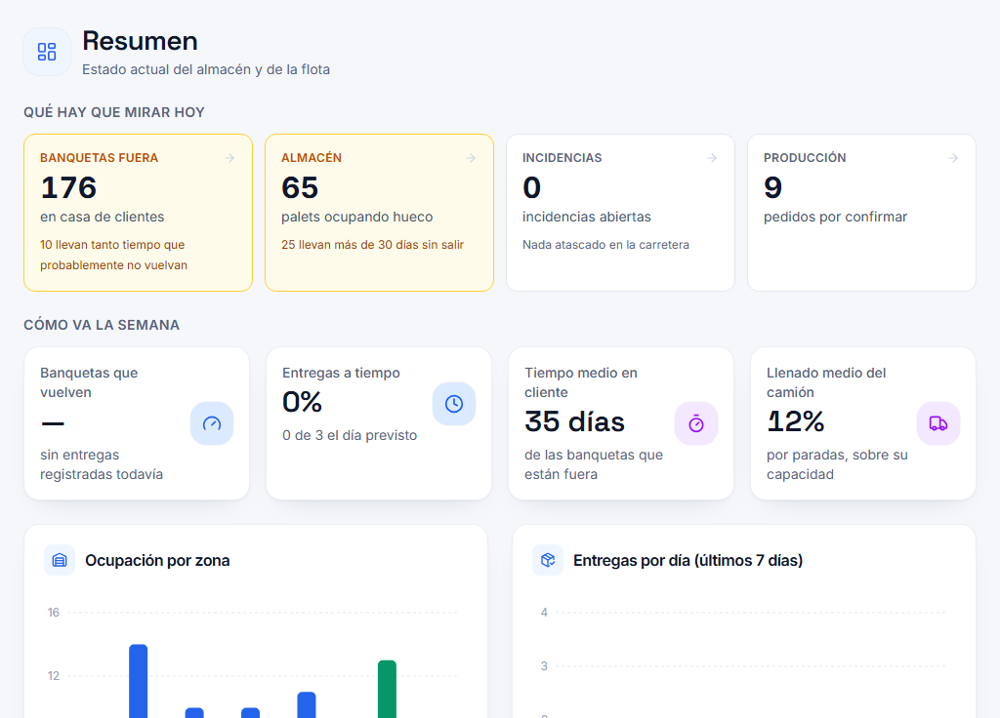
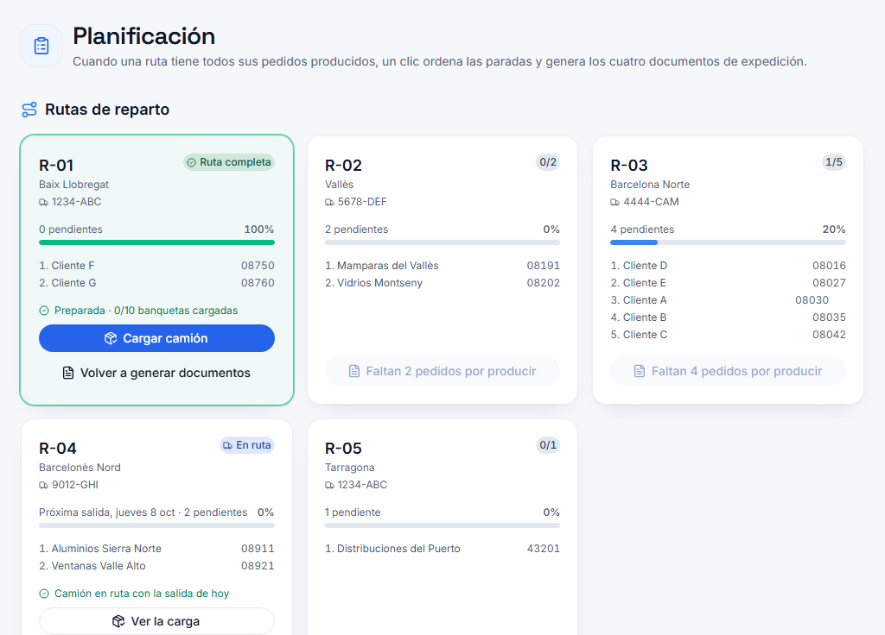
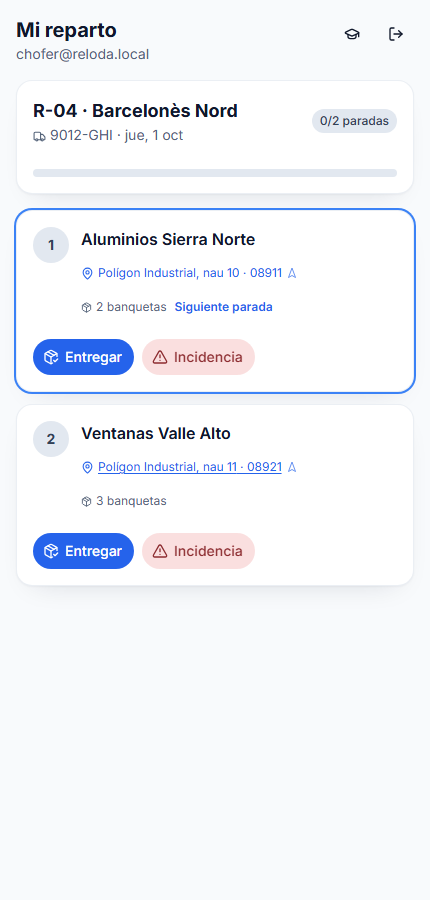

# Reloda — case study

**A SaaS for factories that lend returnable packaging to their customers: it follows every rack from
the order to its return to the plant.** It started as a university team project; after graduation the
rest of the team stepped away, and since July 2026 I have been its sole developer and owner, turning
it into a product deployed for a glass manufacturer.

**[reloda.es/en](https://reloda.es/en)** — the full product: every module and how the whole chain
works ·
**[Live demo](https://app.reloda.es)** — try it yourself with invented data, "Entrar como visitante"
(Enter as visitor)

> The source code is private because Reloda is a commercial product. The website shows *what* it
> does; this page explains *how* it is built. I'm happy to walk through the code in an interview.

<p>
  
  
</p>

*Control panel and route planning (demo data; the UI is in Spanish).*

---

## The problem

Glass travels on steel racks that the factory lends to its customers and expects back. At the factory
I built this for, the logistics team assigned every order to a route and a truck by hand, and nobody —
logistics, sales, customer service, or the customer — could see in real time where an order or a rack
was. The goal was twofold: take the manual work out of route and truck assignment, and give every
person in the chain the same live picture.

## What I built

One application that covers the whole chain, with a different app for each role:

```
Order ─► Manufacturing ─► Filling racks ─► Route planning ─► Loading ─► Delivery ─► Return
                                                                          │
                                                       customer portal follows every step
```

- **Orders** reserve racks the moment they are created, and get a planned truck and departure day that
  is recalculated as production advances. If an order is going to miss its truck, the system says so.
- **Planning** assigns customer → route → day → truck with configurable rules, orders the stops, and
  generates the four documents a truck needs (route sheet, loading order, delivery notes, returnables).
- **Loading** is guided rack by rack, in reverse delivery order, with the exact warehouse slot to pick
  each one from, on desktop or phone, plus a to-scale 2D and 3D view of the trailer.
- **Driver app**: signature and photo on delivery, incidents, empty racks collected. **Works with no
  signal.**

  
- **Customer portal**: each customer sees only their own orders, live.
- **Warehouse**: inventory, QR scanning, a zone map and a walkable 3D model of the warehouse.

Six roles (admin, manager, operator, driver, factory station, customer), each with its own app.

## Architecture

```
  UI (React components)     ← never talks to the database
          │
          ▼
  Services                  ← the only layer that touches Firestore and Auth
          │
          ▼
  Domain                    ← pure TypeScript: no React, no Firebase. This is what is tested.
```

**React 19 · TypeScript · Vite · Tailwind · Three.js (React Three Fiber) · Firebase (Firestore, Auth,
Hosting) · PWA · Sentry**

There is no custom backend: business logic runs in client-side transactions, and **Firestore security
rules are the authorisation layer**. That makes the rules the most important code in the project, so I
treat them that way (see below).

The domain layer holds the state machine for orders and racks, the transport rules engine, the slot
heuristics and the KPIs, as functions that take data and return data. Swapping Firebase for another
backend means rewriting the services; the UI and the domain don't change.

## Decisions worth explaining

**Offline-first for drivers.** Drivers work in industrial estates with patchy coverage. Firestore
transactions need a network connection, so the delivery flow uses batched writes instead: they are
queued locally and sent on reconnect. That gives up optimistic locking, which is fine because one route
belongs to one driver. The batch isn't awaited either (offline, the promise never resolves and the
screen would hang on "saving"). Signatures and photos are written to IndexedDB *before* touching the
network and uploaded later. A retry also runs every 30 s, because `navigator.onLine` reports wifi, not
internet, so the `online` event never fires on a site with signal but no connectivity.

**Security rules as the backend.** Rules in Firestore are additive: if any rule allows a write, it
happens. An early wildcard rule giving staff write access silently cancelled the append-only guarantee
on rack history. Now every collection is listed explicitly and **a new collection is locked by default**.
The role is always read on the server, never sent by the client. Rack history is append-only, even for
admins, because a history that can be edited proves nothing. Customer queries must filter by the
customer's own ID or the whole query is rejected.

**Multi-tenant by deployment.** The public demo and each customer run in separate Firebase projects,
built from the same code with per-install configuration (even the vocabulary: one factory says "rack",
another says "cage").

## Quality

| Layer | How it's tested |
|---|---|
| Domain logic | ~950 unit tests (Vitest), no emulator needed |
| Security rules | ~190 tests against the Firestore emulator |
| User flows | ~75 end-to-end tests (Playwright) against the emulator |

CI runs typecheck, lint, unit tests, build, rules tests and e2e on every push. Pre-commit hooks run
format and lint. About 480 TypeScript files and 100k lines, 280+ commits since I took it over, with a user manual and a technical guide
written alongside the code.

---

Built by [Raúl Jiménez Ayza](https://github.com/RaulJimenezAyza).
